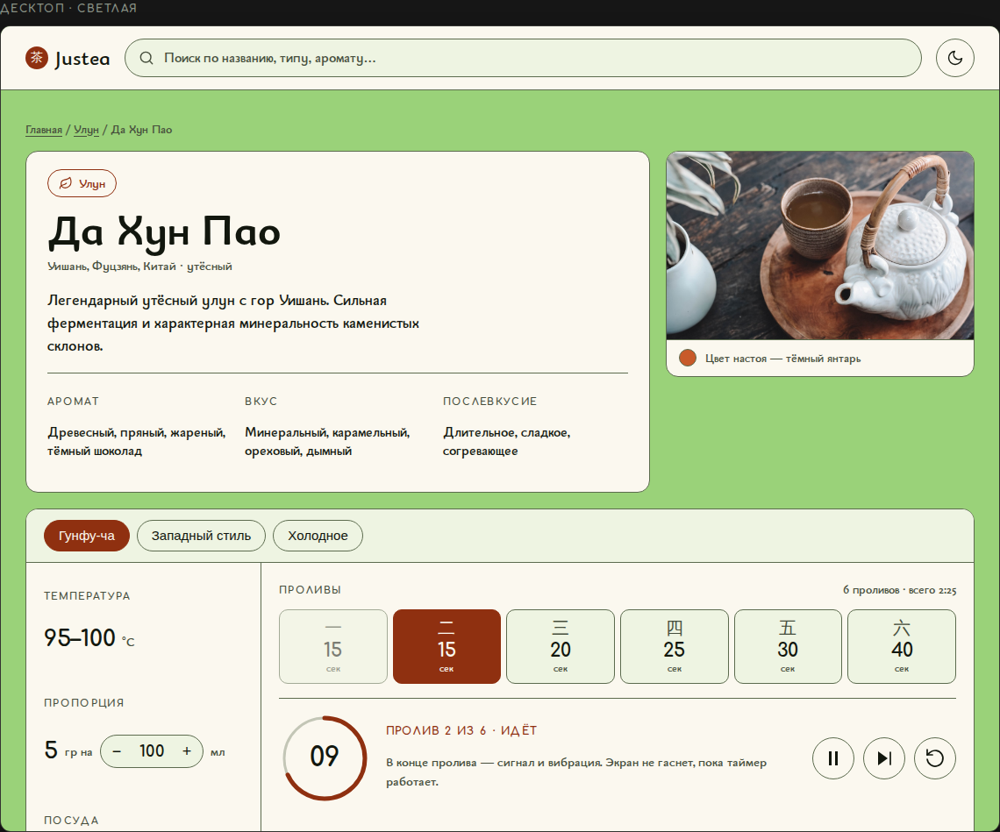
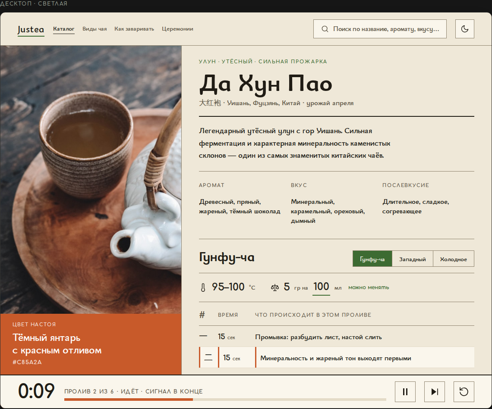
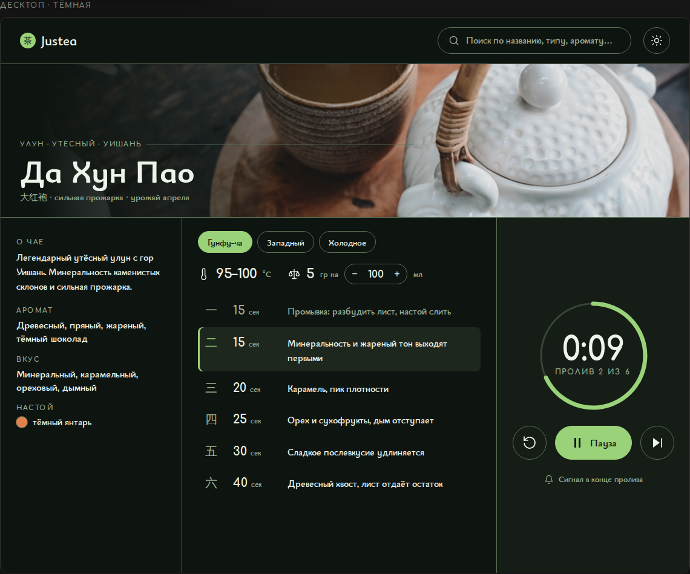
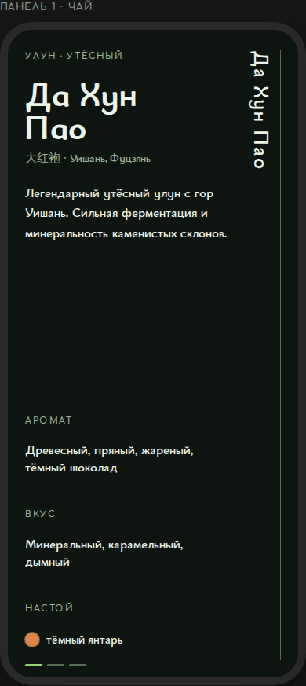
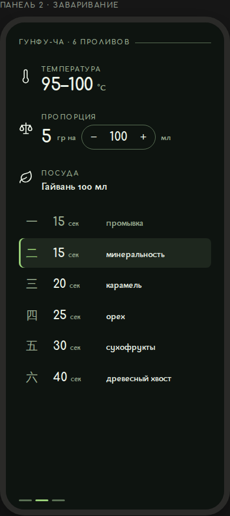
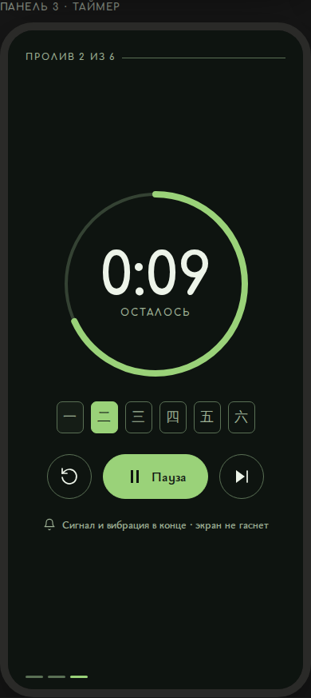

# Три направления визуального стиля Justea

> **Отклонено пользователем 6 ноября 2026.**
> Решение: визуальный интерфейс меняется только точечно или по строгим
> референсам пользователя (повторять минимум на 60 %). Собственные направления
> и редизайны агентов не принимаются. Дизайн-система по A/B/C не делается.
>
> Файлы оставлены как материал исследования: палитры здесь посчитаны по WCAG и
> пригодятся, если пользователь даст референс. Строить на них работу нельзя.
> Точечные починки блокеров без смены облика ведутся отдельно — см.
> [аудит](../audit/README.md).

Дата: 6 ноября 2026. Агент: justea-design.

Основание — [UX/UI-аудит](../audit/README.md). Все три направления закрывают
блокеры из него (фокус, контраст границ, тёмная тема, сигнал таймера, фото
чая, доступ к завариванию на мобильном). Различаются они не починками, а
характером: насколько далеко сайт уходит от нынешнего облика.

## Как смотреть

Живые макеты — статические HTML, открываются двойным кликом, без сборки:

| Направление | Макет | Суть в одной строке |
|---|---|---|
| **A · Гунфу** | [a-gongfu/index.html](./a-gongfu/index.html) | Тот же зелёный, но текст и управление переезжают на бумагу |
| **B · Чайная бумага** | [b-paper/index.html](./b-paper/index.html) | Печатный определитель; страницу красит цвет настоя |
| **C · Свиток** | [c-scroll/index.html](./c-scroll/index.html) | Тёмный чайный стол; на телефоне — панели вбок, таймер во весь экран |

Каждый файл содержит мудборд (палитра с посчитанным контрастом, типографика,
базовые компоненты) и ключевой экран — страницу чая на десктопе и телефоне,
в светлой и тёмной теме. PNG-превью — в [`previews/`](./previews/).

---

## A · «Гунфу» — прибор на зелёном поле

Фирменный зелёный остаётся полем страницы, но перестаёт одновременно быть и
фоном, и поверхностью: текст и органы управления переезжают на тёплую бумагу
`#FBF8EF`. Глубина делается сменой поверхности, а не полупрозрачными рамками —
поэтому границы наконец проходят 3:1. Акцент — терракота настоя `#8F3010`,
ровно один тёплый цвет, и он всегда означает действие. На телефоне параметры и
таймер живут в липкой панели внизу: доступны с первого экрана, а не с третьего.

| | |
|---|---|
| **Сохраняет** | зелёный, Bainsley + Comfortaa, китайские цифры, цвет настоя |
| **Риск** | самое осторожное из трёх: аккуратнее, но не обязательно заметнее |
| **Объём** | наименьший — токены + переразметка страницы чая и карточки |

[Открыть макет →](./a-gongfu/index.html) · [мобильный](./previews/a-mobile-light.png) · [тёмная](./previews/a-mobile-dark.png) · [мудборд](./previews/a-moodboard.png)

---

## B · «Чайная бумага» — печатный определитель

Сайт перестаёт быть зелёным приложением и становится справочником. Фон — тёплая
бумага сюань `#EFE8D8`, зелёный уходит в акцент, а главным цветом каждой
страницы становится **настоящий цвет настоя этого чая**: у Да Хун Пао страница
терракотовая, у Бай Хао Инь Чжэнь — соломенная. Каталог из восьми сортов
перестаёт выглядеть однообразно, а поле `liquorColor` наконец начинает
работать. Ни одного скругления: вёрстка на линейках и колонках. Проливы — не
полоска цифр, а таблица, в которой выводятся `infusions[].notes` (данные уже
есть, на сайте не показываются).

| | |
|---|---|
| **Выигрывает** | выглядит как специализированный справочник; лучшая позиция под SEO-контент |
| **Риск** | зелёный теряет роль фона — бренд придётся держать знаком и типографикой |
| **Объём** | средний — полная замена токенов, новая шапка с разделами |

[Открыть макет →](./b-paper/index.html) · [мобильный](./previews/b-mobile-light.png) · [тёмная](./previews/b-mobile-dark.png) · [мудборд](./previews/b-moodboard.png)

---

## C · «Свиток» — тёмный чайный стол

Развитие эксперимента `sandbox/chinese-scroll-mobile`, доведённое до системы.
Фон — тёмный стол с зелёным подтоном, фирменный зелёный возвращается как
**свет**: им светится активный пролив, кольцо таймера и кольцо фокуса. На
телефоне страница чая перестаёт быть лентой — это три панели, которые листаются
вбок, и **таймер занимает отдельную панель целиком**. Кнопки 56 px: под мокрые
руки рядом с чайником.

| | |
|---|---|
| **Выигрывает** | самый характерный; радикально чинит главный провал мобильной версии |
| **Риск** | горизонтальная навигация непривычна; длинный SEO-текст в панель не влезает — нужен отдельный режим чтения (согласовать с justea-seo) |
| **Объём** | наибольший — другая модель страницы чая, новая логика таймера |

[Открыть макет →](./c-scroll/index.html) · [светлая тема таймера](./previews/c-timer-light.png) · [мудборд](./previews/c-moodboard.png)

---

## Сравнение

| | A · Гунфу | B · Чайная бумага | C · Свиток |
|---|---|---|---|
| Фон светлой темы | зелёный `#9AD279` | бумага `#EFE8D8` | светло-зелёный `#E6ECDD` |
| Роль фирменного зелёного | поле страницы | акцент | свет и акцент |
| Основная тема | светлая | светлая | тёмная |
| Чем красится страница чая | одинаково у всех | цветом настоя | одинаково у всех |
| Форма | скругления 10–14 px | прямые углы | капсулы и круги |
| Проливы | ячейки в ряд | строки таблицы с заметками | строки + «чётки» |
| Таймер | панель в приборе | закладка внизу разворота | отдельный экран |
| Мобильная модель | лента + липкая панель | лента + липкая панель | свиток из трёх панелей |
| Узнаваемость с нынешним сайтом | высокая | низкая | средняя |
| Объём работ | малый | средний | большой |
| Риск | низкий | средний | высокий |

## Что входит в дизайн-систему при любом выборе

Это не предмет выбора — это починка блокеров аудита:

1. Токен фокуса вместо `*:focus { outline: none !important }`.
2. Шкала границ с контрастом ≥ 3:1 в обеих темах (сейчас не проходит ни одна).
3. Тёмная тема как та же система с другой яркостью, а не чёрный шаблон.
4. Типографическая шкала вместо произвольных `text-[NNpx]`.
5. Цели касания от 44 px (сейчас 32–36 px у избранного и кнопок таймера).
6. Фотографии чая на карточке и странице; цвет настоя — как дополнение, а не замена.
7. Сигнал (звук + вибрация) в конце пролива и Screen Wake Lock на время таймера.
8. Исправный выбор объёма воды: степпер вместо поля, ломающего строку.

## Чего в макетах намеренно нет

- **Фотографии чая.** Во всех трёх макетах стоит одна и та же фотография из
  `public/teas/longjing.jpg` как заглушка. Реальная съёмка сухого листа и
  настоя по сортам — отдельная задача; без неё ни одно направление не раскроется.
- **Главная, поиск, каталог по типу, 404.** Прорабатываются после выбора
  направления — в макетах показан только ключевой экран.
- **Переключатель способов заваривания** нарисован с тремя вкладками, но в
  данных у 7 чаёв из 8 способ один. Это вопрос к justea-sources, а не к дизайну.

## После выбора

1. Дизайн-система: токены в `app/globals.css` + базовые компоненты — отдельный PR.
2. Пошаговые PR по экранам, к каждому скриншоты «до/после».
3. Токены и компоненты передаются агенту justea-ceremony, чтобы лендинг
   церемоний был в том же стиле.
